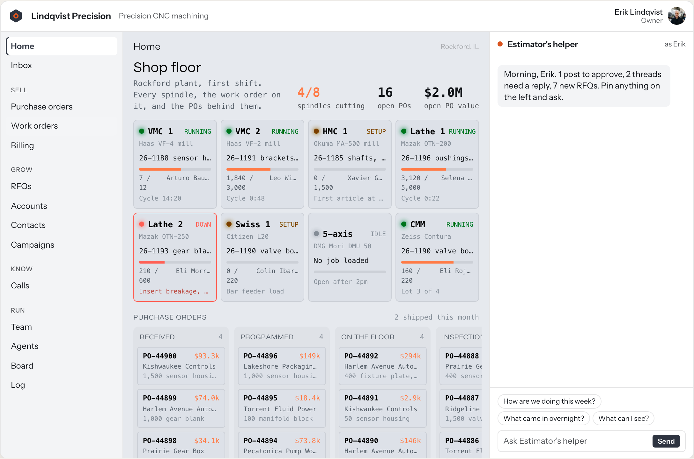
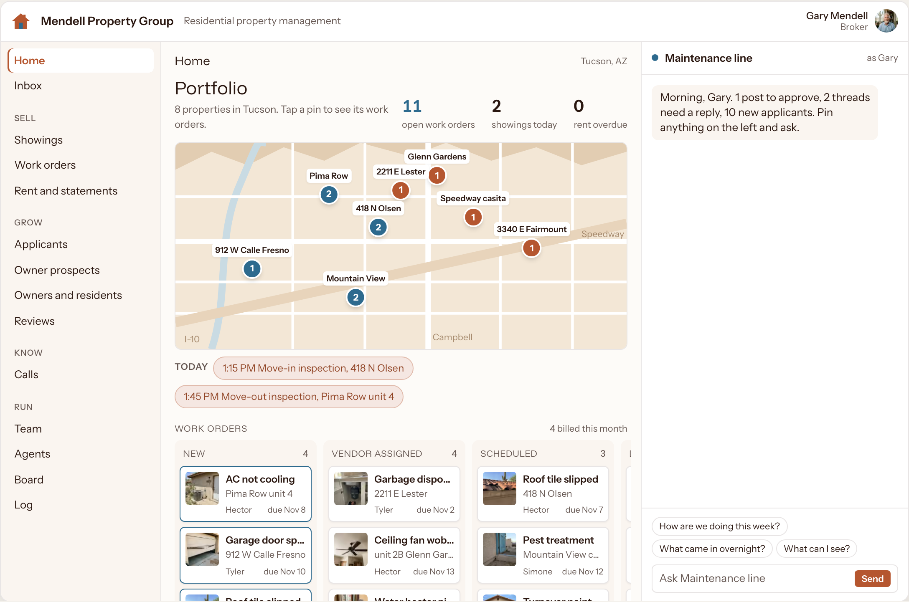
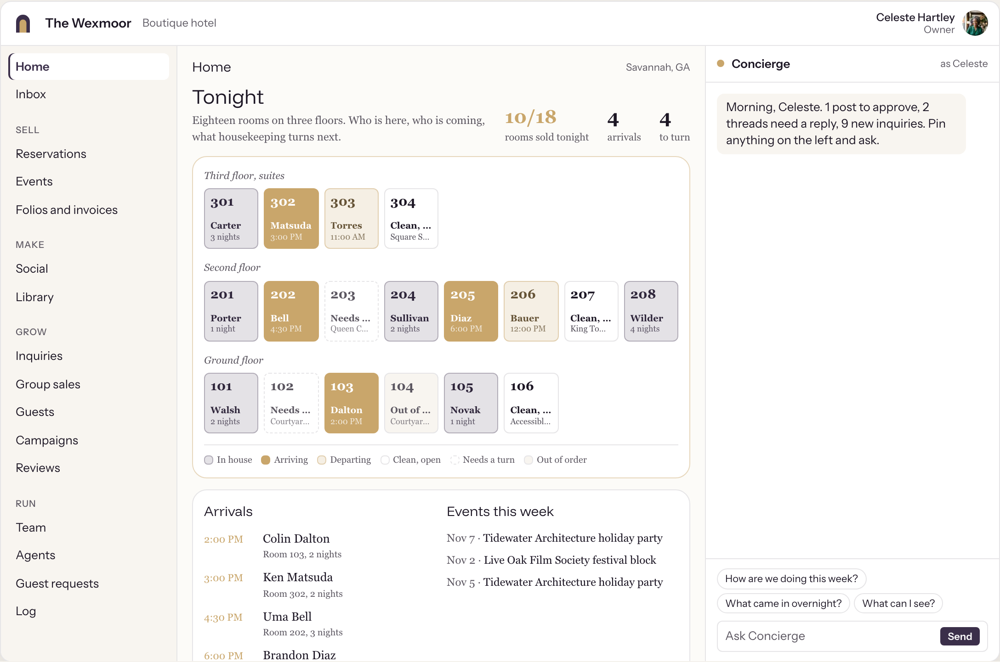
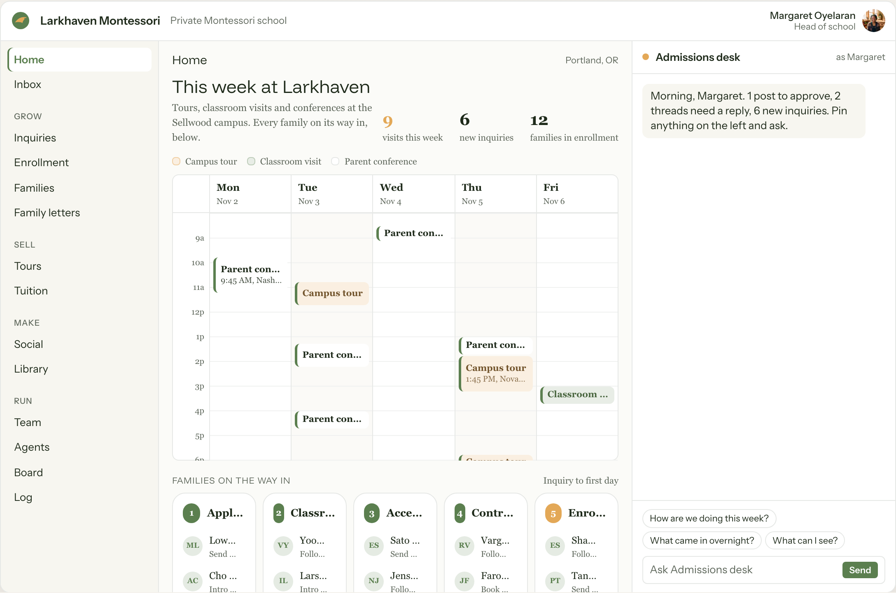
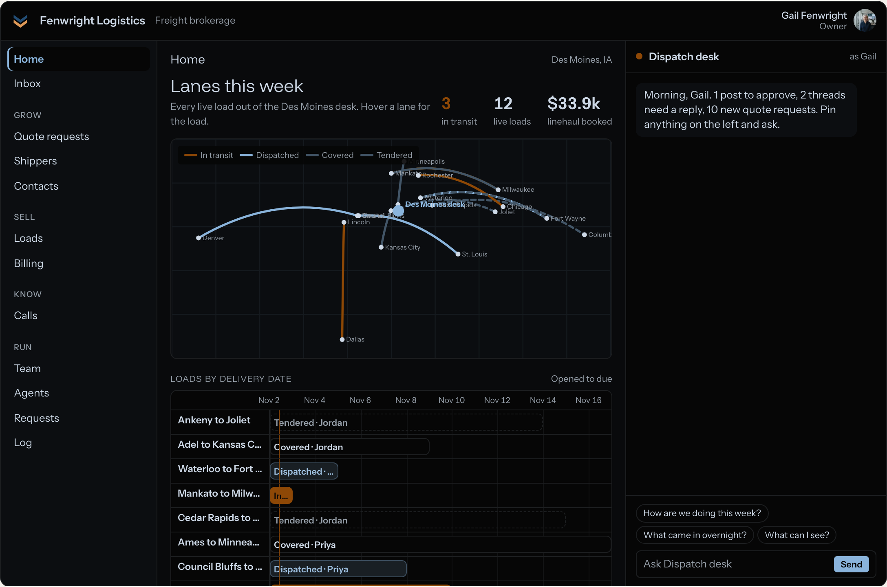
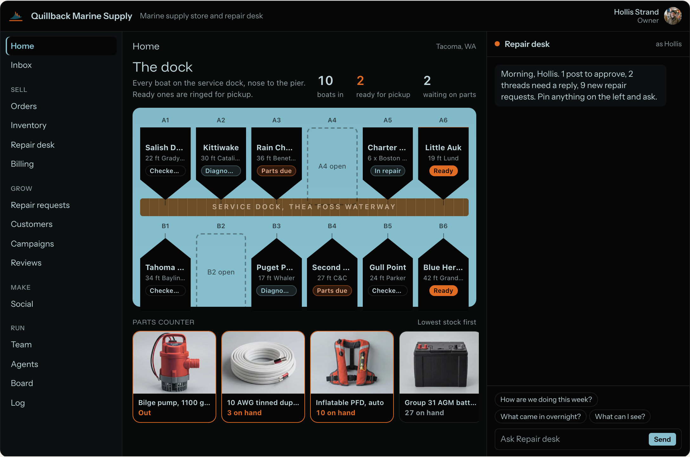
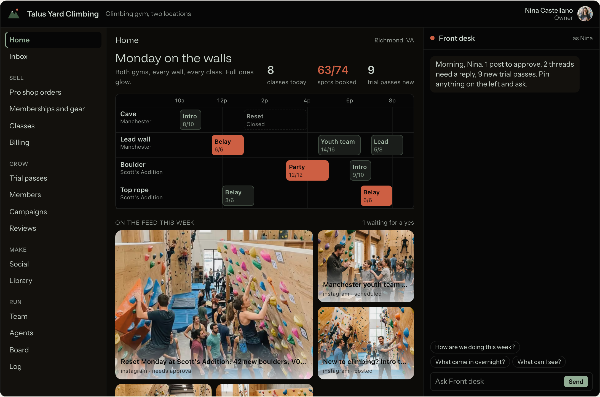
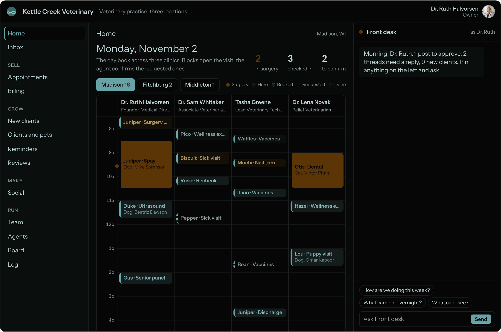

# Your Everything App<sup><del>TM</del></sup>

**YEA.** One app that runs a business: a customer side, an admin side, one left nav, six user types, and an agent in a chat panel on every screen that can see what you see and act on it.

This README is the instructions. If you are an agent and someone pointed you here, follow it top to bottom. If you are a person, open `examples/yea.config.json` to see what one business's app looks like, then hand this to your agent: "Read this repo and follow the README to get my business on YEA."

---

## What it looks like

Same shell, same components, a different first screen for every business. Nobody runs a company from a list. The owner says what they want to see, and the agent builds it: a shop floor, a dock, a map, a room grid, a day book. These are the homes of eight companies in the live demo, the first four in light mode and the last four in dark. The companies, people and numbers are made up. Almost every module behind them already runs in a real business.

| | |
|---|---|
|  |  |
| **Machine shop: Shop floor.** Every spindle live, the job on it, the POs behind them. | **Property management: Portfolio.** Every property on a map, open work orders pinned to it. |
|  |  |
| **Boutique hotel: Tonight.** Every room on three floors: who is in, who is arriving, what housekeeping turns next. | **Private school: This week.** Tours, classroom visits and conferences, and every family on its way in. |
|  |  |
| **Freight brokerage: Lanes this week.** Every live load on a map, then on a timeline by delivery date. | **Marine supply: The dock.** Every slip with its boat and repair, and the parts counter, lowest stock first. |
|  |  |
| **Climbing gym: Monday on the walls.** Every wall and class, and the posts waiting for a yes. | **Vet practice: Monday.** The day book across three clinics, one column per vet. |

---

## What YEA is

- **A theory, not a product.** There is no license, no seat price, no vendor, and no trademark. The TM is struck through on purpose: that is the joke. YEA is what you get when you let the models do what they were trained to do: write the code, from a clear spec, for one business at a time.
- **Own your stack, soup to nuts.** The old fear of owning your software was technical debt and the cost of the engineers to carry it. That fear is going away. The systems are self-managed by AI, and consistent, high-quality software engineering keeps getting cheaper as the models improve, with the cost heading toward zero. In an ecosystem that changes this fast, owning your own stack is the only hedge. Rent it and you move when your vendor moves. Own it and you rewrite it the day something better exists.
- **A spec, not a codebase.** This repo holds the PRDs. You build the app for the business from them, in the stack you choose. Every business gets its own copy and owns it outright.
- **Proven, not invented.** Every core and common module is a pattern already running in production at real businesses. Three modules are "not yet proven": Bookings, Documents and Money. Their admin PRDs and the matching customer portal pages (Bookings, Documents, Invoices) say so at the top. Build those from the spec and test harder. Calls is "partly proven": joining, live checks and the report run in production; asking the back-office agent mid-meeting and speaking on the call do not yet.
- **Configured, not forked.** Every business gets the same shell and the same components. What changes is one config object: which modules are on, what they are called, the stages and fields inside them, the roles, the brand colors. See `shared/modules.md` section 5.

### How this repo is laid out

Folders mirror the left nav. If a page is in the nav, it has a folder with a `PRD.md`. Each group folder (`grow/`, `sell/`...) holds one folder per page, so Leads lives at `admin/grow/leads/PRD.md`.

```
README.md                  you are here
shared/
  PRD-TEMPLATE.md          the headings every PRD uses
  modules.md               the module map: nav tree, tiers, routes, config knobs
  roles.md                 six user types, eight verbs, the permission matrix, agent rules
  chat.md                  the right-hand chat panel and how it selects things on the page
  data-model.md            database conventions and the tables every module shares
  design-system.md         shell, left nav, lists, record views, chips, buttons
  saas.md                  what YEA replaces, what it keeps, by risk level
  saas.json                the same data, machine readable
examples/
  yea.config.json          a filled-in config for a fictional business: start here
playbooks/
  README.md                six business archetypes and every play we built, each citing the file that does it
admin/
  home/
  inbox/
  grow/    leads/  pipeline/  people/  prospects/  outreach/  campaigns/  reviews/  programs/  reps/
  sell/    orders/  catalog/  bookings/  jobs/  marketplace/  documents/  money/
  make/    content/  social/  library/  studio/
  know/    insights/  search/  views/  goals/  costs/  playbook/
  run/     team/  agents/  board/  log/  settings/
customer/
  site/
  shop/
  intake/
  portal/  home/  orders/  reorder/  bookings/  documents/  invoices/  rewards/  leads/  listing/  posts/  kit/  account/
```

**Playbooks.** Before you pick modules, read [`playbooks/README.md`](playbooks/README.md). It maps six business archetypes (lead marketplace, product brand, field service, professional practice, creator, nonprofit) to the modules, stages, agent jobs and plays we have already built for real businesses like them. Start from the closest archetype, then adjust.

Read `shared/` before any module PRD. The module PRDs assume you know the shell, the roles and the chat.

---

## 1. Before you build

Interview the owner. Do not pick a single module until you have these six answers. Ask them one at a time, in plain words, and write the answers down in the business's repo as `docs/interview.md`.

1. **What do you do?** One sentence. "We install and service commercial walk-in coolers."
2. **What industry are you in?** Their word, not yours.
3. **Tell me about the business in two sentences.** Who buys, how they find you, what a good month looks like.
4. **What is your website URL?** Read it. Pull the services, the locations, the voice, the colors and the logo from it. If they have no site, say so and move on.
5. **Who will use the app?** Name the people and what they do: the owner, the office, the crew, outside reps or partners, and which customers should be able to sign in. This becomes the roles in step 3.
6. **What do you pay for today?** Every app and subscription, with the monthly cost if they know it. Look each one up in `shared/saas.md`. This list decides what you build first and what you move off last.

Then ask one follow-up: **"What is the job nobody has time for?"** That is the first thing the agent should do once the app is live.

Write the result as the config object from `shared/modules.md` section 5 (`AppConfig`): company name, industry, URL, brand colors, groups, modules, customer kinds, role labels. Save it as `yea.config.json` at the root of the business's app. For a filled-in example, see `examples/yea.config.json`: a fictional commercial refrigeration company with Sell first, Jobs relabeled "Work orders" and Staff relabeled "Techs". Show it to the owner as a list of nav items, not as JSON.

---

## 2. Pick modules

`shared/modules.md` has 38 modules in three tiers.

| Tier | Rule | Modules |
|---|---|---|
| **core** (14) | Always on. You may relabel, never remove. | Home, Inbox, Leads, People, Views, Goals, Team, Agents, Board, Log, Settings, Site, Intake, Portal (Home, Account) |
| **common** (19) | On if the business does that work or pays for that SaaS today. | Pipeline, Outreach, Campaigns, Reviews, Orders, Catalog, Bookings, Documents, Money, Content, Social, Library, Studio, Insights, Search, Costs, Playbook, Calls, Shop |
| **industry** (5) | On for one business model. At most two per business. | Prospects, Programs, Reps, Jobs, Marketplace |

How to choose:

1. Turn on every core module.
2. For each SaaS product in the interview answer to question 6, find its module in `shared/saas.md` and turn that module on.
3. Turn on any common module the interview describes even if no SaaS covers it today (a business that sends quotes on paper still needs Documents).
4. Pick industry modules only from the business model: B2B selling at volume (Prospects), consumer brand with loyalty (Programs), field sales team (Reps), service or project work delivered after the sale (Jobs), routing or reselling leads or work (Marketplace).
5. Relabel in their words. A law firm's Jobs is "Matters". A clinic's Bookings is "Appointments". A wholesaler's Pipeline is "Accounts". The key never changes; only `label` does.
6. Set group order to how their day runs. The default is Grow, Sell, Make, Know, Run. A shop that lives on orders puts Sell first.

Show the owner the left nav that results, top to bottom, before you write any code. Cut anything they do not recognize.

---

## 3. Set roles

`shared/roles.md` is the full spec. The short version:

- **Six user types, fixed:** Owner, Admin, Staff, Contractor, Customer, Agent. Every user has exactly one admin-side type. A type is a ceiling.
- **Named roles sit on top** and only trim. Ship the four presets (Viewer, Bookkeeper, Reviewer, Sales without personal data) and let the owner add more.
- **Eight verbs on every module:** View, Create, Edit, Approve, Send/Publish, Delete, Export, Configure. Spend is a flag on any action that moves money.
- **Scope is `all` or `own`.** Contractors and Customers are always `own`.
- **The agent is a user, never a superuser.** In chat it acts as the person who opened the chat. In the background it acts as the role the owner picks. It never approves and never configures. Every write it makes is logged with Undo. Every send, publish, spend and delete waits for a human yes until the owner relaxes that module.
- **One function, `can(user, module, verb, record?)`,** checked in four places: the nav, the route guard, every server action, every agent tool. Row rules in the database back it up.

Map each person from interview question 5 to a type, then to a preset or a named role. Seed `role_grants` from the matrix in `shared/roles.md` section 4.

---

## 4. Stack

**Default:**

| Layer | Default |
|---|---|
| App | Next.js (App Router), TypeScript, server components and server actions |
| Database | Postgres on Neon |
| Hosting | Vercel |
| Email delivery | SendGrid (send and inbound parse) |
| Payments | Stripe |
| SMS and voice | Twilio, only if a module needs it |
| Auth | Magic links, no passwords. Sessions in the database. Same-browser check skips the second click (`admin/run/team/` Sign-in) |
| Analytics | First party only: own cookie, own middleware, own tables. No Google Analytics |
| Model | Any capable model with tool use and streaming. Open-weight models work. Pick per task and log the cost of every call (Costs module) |

**Any stack works.** The PRDs describe jobs, pages, data, permissions and acceptance criteria, not frameworks. Rails, Django, Laravel, Phoenix, Go: build it in what the business or its team already runs. Three things are not optional in any stack:

1. A relational database with row-level rules, so `own` scope holds even when application code is wrong.
2. Server-side permission checks on every write.
3. Streaming from the agent to the chat panel, with tool calls the page can react to (see `shared/chat.md`).

Keep the app in **one repo** the business owns, with its own hosting account and its own database. The public marketing site and the admin back office live in that same repo and ship together. If you are a vendor building it for them, put everything in their name from day one.

**No Google Analytics.** Tracking is first party: a cookie set by the business's own domain, page views written by the app's own middleware into its own database (`admin/know/insights/`). No third-party tag by default.

### The smallest YEA

The most basic deployment is a **marketing site plus a back office where you manage the leads it captures**: Site, Intake, Leads, with the shell, Log, Team (sign-in) and the chat underneath. Everything else is a module you turn on later. Ship this first for any new business, then grow it.

---

## 5. Build order

Build in this order. Do not start a module until the one before it passes its acceptance criteria.

1. **Shell.** Auth (magic links), tenant, `yea.config.json` loader, left nav rendered from config and `can()`, the profile menu, light and dark themes, top bar, URL modals, the list kit (search, filters, sort, quick views, all in the URL), pending buttons. `shared/design-system.md`.
2. **Log and roles.** `change_log` with before, after and Undo; `role_grants`; `can()`; the hidden, read-only and disabled rules. Every later write goes through these. `admin/run/log/`, `shared/roles.md`.
3. **Chat panel.** The right-hand panel, anchors on every list row and record, `page_context`, the three UI events, the Changes tab. Build it now, empty of tools, so every module after this adds its anchors and tools as it goes. `shared/chat.md`.
4. **Run.** Settings, Team, Agents, Board.
5. **Core data.** People, Leads, Inbox, then Home (Home reads from everything, so it comes after the things it reads).
6. **Customer side.** Site, Intake (lands in Leads), Portal Home and Account.
7. **Know.** Views and Goals (core), then Insights, Costs, Search, Playbook if on.
8. **Common and industry modules**, in the order the owner will cancel SaaS: the ones that replace "No brainer" products first, "Careful" last. See section 7.

For every module:

1. Read its `PRD.md` and the shared files it links to.
2. Write the migration. Follow `shared/data-model.md`.
3. Build the pages and states the PRD lists, in nav-tab order.
4. Add the anchors and agent tools the PRD lists. Wire each tool through `can()` and `change_log`.
5. Seed it with the sample generator the PRD names, using fictional data only.
6. Check every acceptance criterion as each user type, using the profile switcher.
7. Show the owner on their phone and their laptop. Ship. Then the next module.

Ship each module to production when it passes. Do not hold the whole app for a big launch.

---

## 6. Keep these rails

YEA replaces the apps. It does not replace the rails. A rail is infrastructure, a license, or a regulated service that moves money, mail, messages or filings. Plug into it and keep it.

| Rail | Why it stays | Examples |
|---|---|---|
| Hosting | Global edge, deploys and scaling are a vendor job | Vercel, Netlify |
| Database | The data you cannot lose. Backups and point-in-time restore | Neon |
| DNS and security | One bad record takes the site and the email down together | Cloudflare |
| Email delivery | Inbox placement is reputation built over years | SendGrid, Postmark, Resend |
| SMS and voice | Carrier access and registration are regulated | Twilio |
| Payments | PCI, fraud and money transmission licenses. YEA never touches a card number | Stripe, Square, PayPal |
| Domains | The registrar holds the legal record of the domain | Any accredited registrar |
| Banking | Deposits sit under a charter. YEA reads balances, never holds money | Any business bank |
| Payroll tax | Filing errors cost penalties. YEA shows the data, the rail files | Gusto, Rippling |
| Passwords | Secrets for every system, including YEA | 1Password |

Full list with prices and sources: `shared/saas.md`, "You still need these".

Every module PRD lists the rails it uses under **Integrations**. If a module needs a platform's own API (a social network, a search engine, an ad account), that is the channel itself, not SaaS you are replacing.

---

## 7. Moving off SaaS safely

Every product in `shared/saas.md` carries a risk level. Move in that order, lowest first.

| Level | Label | What is at stake | How to move |
|---|---|---|---|
| none | **No brainer** | Nothing. | Build the module, switch over, cancel this week. |
| low | **Easy** | Data that exports cleanly. | Export, import, check counts match, switch, cancel after one billing cycle. |
| mid | **Plan it** | Live revenue, contracts, consent records, or history the business runs on. | Written migration plan. Run both side by side until a full cycle matches (a month of orders, every active subscription billed once, every flow fired once). Redirect every old URL. |
| high | **Careful** | Money, compliance, deliverability, or data you cannot lose. | Move last. Full parallel run: one complete month-end close for the books, one full mail cycle plus the MX cutover for email. The owner signs off in writing. Or keep it. |

Rules that apply at every level:

1. **Export before you cancel.** Keep the raw export in the business's own storage, not just in YEA.
2. **Carry suppression lists.** Unsubscribes, bounces and do-not-contact records move first, before a single send from YEA.
3. **Carry consent.** SMS opt-ins and email consent move with their timestamps and source. Port phone numbers together with their consent log.
4. **Archive signed documents with their audit trail** before leaving an e-signature tool.
5. **Redirect old URLs** when a site or store moves, or the business loses its search rank.
6. **Count, then cut.** Before cancelling, compare record counts and totals between the old tool and YEA and show the owner the numbers.
7. **Show the savings.** Keep a running list of what was cancelled and its monthly price. That number is the owner's proof.

---

## Want people to do it?

postscarcity.ai, book a call.

Good on YEA.
