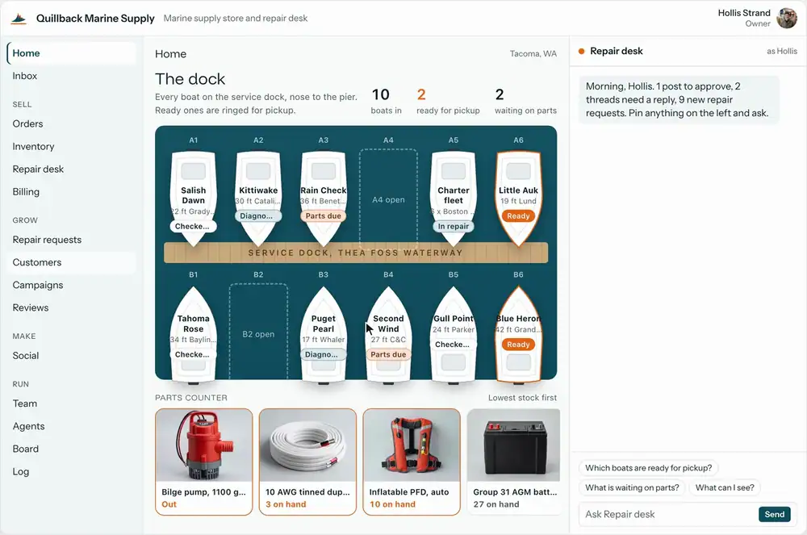
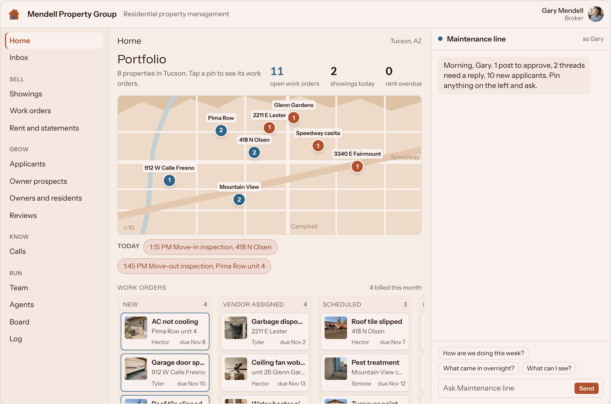
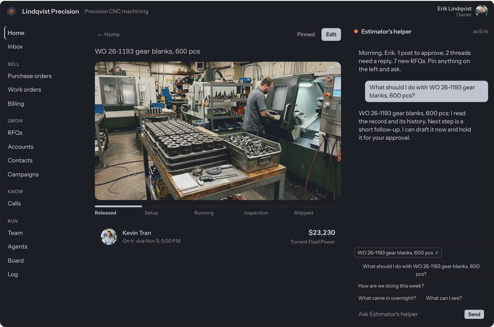
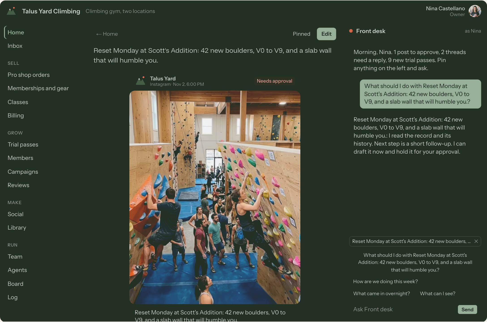
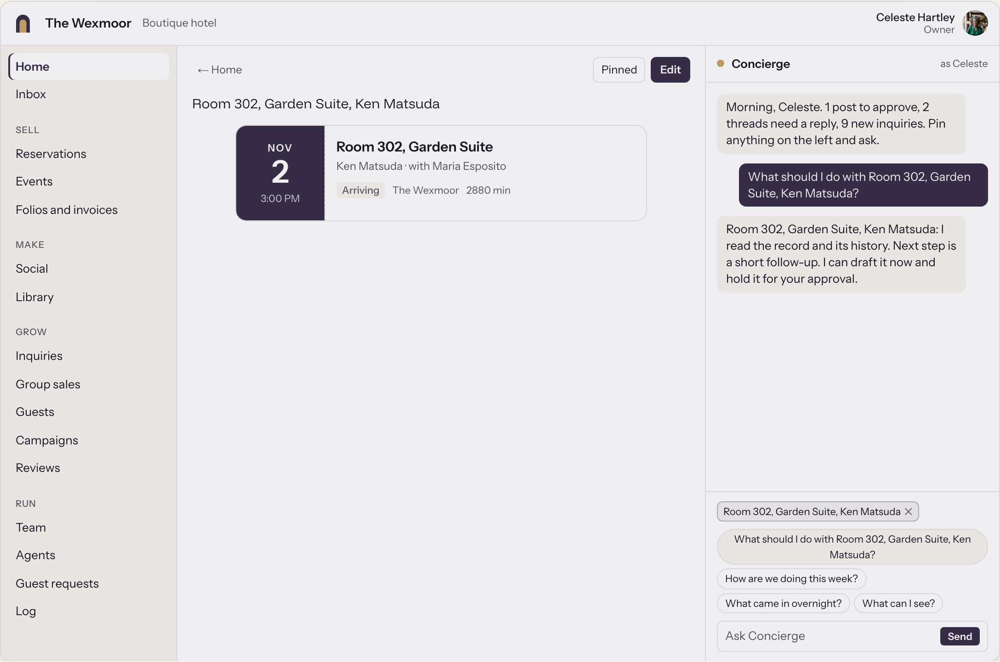

# Your Everything App<sup><del>TM</del></sup>

**This is the reference for building your own.** What to build, how to build it, and what we learned building it for real businesses.

**YEA** is one app that runs a business: a customer side, an admin side, one left nav, six user types, and an agent in a chat panel on every screen that can see what you see and act on it. There is nothing to install and nothing to clone. Your agent reads this and builds your app, in your repo, and you own it.

This README is the instructions. If you are an agent and someone pointed you here, follow it top to bottom. If you are a person, open `examples/yea.config.json` to see what one business's app looks like, then hand this to your agent: "Read this repo and follow the README to get my business on YEA."

---

## What it looks like

Same shell, same components, a different first screen for every business. Nobody runs a company from a list. The owner says what they want to see, and the agent builds it: a dock, a shop floor, a map, a room grid. The chat on the right is wired to the page: click anything to hand it to the agent, and the agent points back at what it is talking about.



**Marine supply: The dock.** Ask which boats are ready and they light up on the dock. Click a boat to pin it, have the agent draft the owner a pickup text, say yes, and the boat is marked owner notified.

| | |
|---|---|
|  |  |
| **Property management.** A work order opened from the map, pinned, and the agent's next step. | **Machine shop, dark mode.** A job off the shop floor, pinned and asked about. |
|  |  |
| **Climbing gym, dark mode.** A post waiting for a yes, handed to the front desk agent. | **Boutique hotel.** Tonight's arrival, pinned to the concierge. |

Both themes take their color from the business's own brand. The companies, people and numbers are made up. Almost every module behind them already runs in a real business.

---

## What YEA is

- **A theory, not a product.** It's MIT licensed, with no license fee, no seat price, no vendor, and no trademark. The TM is struck through on purpose: that is the joke. YEA is what you get when you let the models do what they were trained to do: write the code, from a clear spec, for one business at a time.
- **Own your stack, soup to nuts.** The old fear of owning your software was technical debt and the cost of the engineers to carry it. That fear is going away. The systems are self-managed by AI, and consistent, high-quality software engineering keeps getting cheaper as the models improve, with the cost heading toward zero. In an ecosystem that changes this fast, owning your own stack is the only hedge. Rent it and you move when your vendor moves. Own it and you rewrite it the day something better exists.
- **A reference, not a codebase.** This repo holds the PRDs, the playbooks and the practices. You build the app for the business from them, in the stack you choose. Every business gets its own app and owns it outright.
- **Proven, not invented.** Every core and common module is a pattern already running in production at real businesses. Three modules are "not yet proven": Bookings, Documents and Money. Their admin PRDs and the matching customer portal pages (Bookings, Documents, Invoices) say so at the top. Build those from the spec and test harder. Calls is "partly proven": joining, live checks and the report run in production; asking the back-office agent mid-meeting and speaking on the call do not yet. Interviews is "partly proven": voice interviews run in production; the review pattern (the agent reads back what the business says and asks for reactions) is new.
- **One shape, many businesses.** Every app follows the same shell, nav, roles and chat from this reference. What changes is one config object: which modules are on, what they are called, the stages and fields inside them, the roles, the brand colors. See `shared/modules.md` section 5.
- **It keeps learning.** This reference improves as we build. Your agent reads what changed, decides what is worth taking, and leaves the rest. See `shared/updating.md`.

### How you get one

1. **Set up the accounts and tools** in the business's name: GitHub, hosting, database, model and media keys, and their CLIs (section 0).
2. **Start a new repo the business owns.** You don't fork this one. Your app has no upstream, so nothing here can ever overwrite it.
3. **Build from the reference**, following the steps below: interview, modules, roles, stack, build order. Ship the smallest YEA first: a site and a CRM.
4. **Write down what you built from.** Record this repo's commit in `yea.lock.json`.
5. **Connect an agent.** The agent in the chat panel is the default. A business's own Hermes connects through the back office. See `shared/agent-platform.md`.
6. **Keep up.** On a schedule, your agent reads the changes since that commit and decides adopt, adapt or skip. See `shared/updating.md`.
7. **Give back.** With the owner's yes, your agent sends what went wrong as a pull request, with nothing personal in it. Every build makes the next one easier. See section 8 and `CONTRIBUTING.md`.

### How this repo is laid out

Folders mirror the left nav. If a page is in the nav, it has a folder with a `PRD.md`. Each group folder (`grow/`, `sell/`...) holds one folder per page, so Leads lives at `admin/grow/leads/PRD.md`.

```
README.md                  you are here
CHANGELOG.md               every change to this reference: what, why, where it's proven
CONTRIBUTING.md            how an agent sends learnings back, and what must never be in them
shared/
  PRD-TEMPLATE.md          the headings every PRD uses
  modules.md               the module map: nav tree, tiers, routes, config knobs
  security.md              the security basics
  change-video.md          how a change gets approved: a short video and a yes
  roles.md                 six user types, eight verbs, the permission matrix, agent rules
  chat.md                  the right-hand chat panel and how it selects things on the page
  interview-tool.md        one realtime voice interview anyone can take, signed in or by link, used by Interviews and Testimonials
  feedback-mode.md         staff tap parts of the live site and leave a comment that lands on the Board
  agent-platform.md        how agents connect, where they run, what they may do alone, hand-off, one repo
  updating.md              how a business's app stays current with this reference
  data-model.md            database conventions and the tables every module shares
  design-system.md         shell, left nav, lists, record views, chips, buttons
  saas.md                  what YEA replaces, what it keeps, by risk level
  saas.json                the same data, machine readable
examples/
  yea.config.json          a filled-in config for a fictional business: start here
playbooks/
  README.md                six business archetypes and every play we built, each citing the file that does it
conformance/
  check.mjs                runnable checks for the rules every app must keep. Put it in CI
change-video/
  make.py                  script to finished video, for the change-video step
practices/
  running-agents.md        how we run a company on agents: capture, owners, proof, gates, quiet, monitors
  traps.md                 specific failures from real builds and the fix
  learnings/               lessons sent back by builds, waiting to be folded into traps.md
admin/
  home/
  inbox/
  grow/    leads/  pipeline/  people/  prospects/  outreach/  campaigns/  reviews/  testimonials/  programs/  reps/
  sell/    orders/  catalog/  bookings/  jobs/  marketplace/  documents/  money/
  make/    content/  social/  library/  studio/
  know/    insights/  search/  views/  goals/  costs/  playbook/  calls/  interviews/
  run/     team/  agents/  board/  log/  settings/
customer/
  site/
  shop/
  intake/
  portal/  home/  orders/  reorder/  bookings/  documents/  invoices/  rewards/  leads/  listing/  posts/  kit/  account/
```

**Playbooks.** Before you pick modules, read [`playbooks/README.md`](playbooks/README.md). It maps six business archetypes (lead marketplace, product brand, field service, professional practice, creator, nonprofit) to the modules, stages, agent jobs and plays we have already built for real businesses like them. Start from the closest archetype, then adjust.

Read `shared/` before any module PRD. The module PRDs assume you know the shell, the roles and the chat. Read `practices/` before you put an agent to work.

---

## 0. Set up the accounts and tools

Do this first, with the owner, before the interview. Every account is in the business's name, never yours. Most of the build stalls later are a missing login, a missing key or a missing CLI, so finish this list before you write any code.

**Tools on the machine.** Check each one runs and print its version: `git`, Node (LTS) with `pnpm`, and the CLI for each service below. Install what is missing.

| Service | What it is for | CLI | Check it works |
|---|---|---|---|
| **GitHub** | The business's repo, and the way you send learnings back (section 8) | `gh` | `gh auth status` |
| **Vercel** | Hosting for the site, the back office and the chat agent | `vercel` | `vercel whoami` |
| **Neon** (or Supabase) | The Postgres database | `neonctl` (or `supabase`) | `neonctl me` |
| **OpenRouter** | One key for the models the agent uses | none, API key | a one-line test call that returns text |
| **fal** | Image and video generation for content modules | none, API key | a one-line test call that returns a job |
| **SendGrid** | Sign-in links and outbound email | none, API key | send a test email to the owner |
| **Stripe** | Payments, only when a payment module is on | `stripe` | `stripe whoami` or a test-mode call |
| **Beam or Fly** | Workers, only when a module needs one (section 4) | `beam` or `fly` | `beam whoami`, `fly auth whoami` |
| **Domain registrar** (Namecheap or any other) | Owns the domain name. Nothing else lives here | none | the domain shows the Cloudflare nameservers |
| **Cloudflare** | DNS for every domain, managed in one place | `wrangler` (optional) | `dig +short NS <domain>` returns Cloudflare |

Rules:

1. **Turn on two-factor sign-in** for every account. The owner holds the recovery codes.
2. **Keys go in the host and in `.env.local`, never in chat, a commit or a screenshot.** List every key's name, with no value, in `.env.example` the moment you add it.
3. **One key per service per app.** Name it after the app, so it can be revoked without breaking anything else.
4. **Set a spend limit** on every metered service (models, image generation, workers) before the first call.
5. **Prove each one with a real call**, not a success message. A CLI can say "logged in" against the wrong account or team.

Write what you set up, with no values, to `docs/setup.md`: each service, which account, which CLI version, and what was checked.

### First app? Open the pages for them

Most owners have never set up their own app. The list above is a wall of sign-ups to them, and it is where a first build most often stops. So the agent does the legwork and the owner only does the parts that need a person. These should be the last platforms the business ever needs: everything later is a module on top of them.

If you can drive a browser (Chrome use, a browser extension, or the desktop app), work like this:

1. **Open one tab per service, in order, in the owner's own browser.** GitHub first, because Vercel and Neon can sign in with it. Then Vercel, Neon, the registrar and Cloudflare, SendGrid (its domain check needs the DNS from Cloudflare), OpenRouter, fal, and Stripe or Beam/Fly only when a module needs them.
2. **Go to the exact page, not the home page.** The sign-up form, the API keys page, the billing limits page. Fill in what you can: the business name, the email, the project name, the settings from this spec.
3. **Hand over only what needs a person,** one at a time, saying exactly which tab and which button: choosing a password, two-factor setup, a card number, ID checks, a CAPTCHA, accepting terms. Never type a password or a card number yourself, and never keep one.
4. **Check each one before you open the next tab.** Run the CLI check from the table. If it fails, fix it now, not at deploy time.
5. **Say what is done and what is left** after every tab, as a short checklist. The owner can stop and pick up later without losing the place.

Without a browser, send the owner the same list as direct links, one per line, with the one thing to do on each page.

**Domains.** Keep buying domains where the owner already does (Namecheap, for example). Then, at the registrar, set the domain's nameservers to the two Cloudflare gives you, and manage all DNS in Cloudflare from then on. One place for every record, every domain. For a site on Vercel, add these in Cloudflare:

| Type | Name | Value | Proxy |
|---|---|---|---|
| `A` | `@` | `76.76.21.21` | DNS only (grey cloud) |
| `CNAME` | `www` | `cname.vercel-dns.com` | DNS only (grey cloud) |

Leave the proxy off for anything Vercel serves. Vercel issues the HTTPS certificate itself, and a proxied record can block that. Add the domain to the Vercel project too (`vercel domains add <domain>`), then prove it with a real `https://` request to both the bare domain and `www`.

---

## 1. Before you build

Interview the owner. Do not pick a single module until you have these six answers. Ask them one at a time, in plain words, and write the answers down in the business's repo as `docs/interview.md`.

1. **What do you do?** One sentence. "We install and service commercial walk-in coolers."
2. **What industry are you in?** Their word, not yours.
3. **Tell me about the business in two sentences.** Who buys, how they find you, what a good month looks like.
4. **What is your website URL?** Read it. Pull the services, the locations, the voice, the colors and the logo from it. If they have no site, say so and move on.
5. **Who will use the app?** Name the people and what they do: the owner, the office, the crew, outside reps or partners, and which customers should be able to sign in. This becomes the roles in step 3.
6. **What do you pay for today?** Every app and subscription, with the monthly cost if they know it. Look each one up in `shared/saas.md`. This list decides what you build first and what you move off last.

Then ask one follow-up: **"What is the job nobody has time for?"** That is the first thing the agent should do once the app is live.

Write the result as the config object from `shared/modules.md` section 5 (`AppConfig`): company name, industry, URL, brand colors, groups, modules, customer kinds, role labels. Save it as `yea.config.json` at the root of the business's app. For a filled-in example, see `examples/yea.config.json`: a fictional commercial refrigeration company with Sell first, Jobs relabeled "Work orders" and Staff relabeled "Techs". Show it to the owner as a list of nav items, not as JSON.

---

## 2. Pick modules

`shared/modules.md` has 40 modules in three tiers.

| Tier | Rule | Modules |
|---|---|---|
| **core** (14) | On by default. Relabel freely. Nothing is required: switch off what the business will not use. | Home, Inbox, Leads, People, Views, Goals, Team, Agents, Board, Log, Settings, Site, Intake, Portal (Home, Account) |
| **common** (21) | On if the business does that work or pays for that SaaS today. | Pipeline, Outreach, Campaigns, Reviews, Testimonials, Interviews, Orders, Catalog, Bookings, Documents, Money, Content, Social, Library, Studio, Insights, Search, Costs, Playbook, Calls, Shop |
| **industry** (5) | On for one business model. At most two per business. | Prospects, Programs, Reps, Jobs, Marketplace |

How to choose:

1. Start from the core modules, and switch off any the business will not use. An app can start as one or two modules.
2. For each SaaS product in the interview answer to question 6, find its module in `shared/saas.md` and turn that module on.
3. Turn on any common module the interview describes even if no SaaS covers it today (a business that sends quotes on paper still needs Documents).
4. Pick industry modules only from the business model: B2B selling at volume (Prospects), consumer brand with loyalty (Programs), field sales team (Reps), service or project work delivered after the sale (Jobs), routing or reselling leads or work (Marketplace).
5. Relabel in their words. A law firm's Jobs is "Matters". A clinic's Bookings is "Appointments". A wholesaler's Pipeline is "Accounts". The key never changes; only `label` does.
6. Set group order to how their day runs. The default is Grow, Sell, Make, Know, Run. A shop that lives on orders puts Sell first.

Show the owner the left nav that results, top to bottom, before you write any code. Cut anything they do not recognize.

Then show where it can grow. Build two or three **growth modes** (`shared/design-system.md` section 2b): the simple app they start with, then one or two that add the modules they may want later, shown as previews. The owner sees the path from a small tool to a full operating system for their business, and you both see what to build next. Delete the modes nobody needs once the exploring is done.

---

## 3. Set roles

`shared/roles.md` is the full spec. The short version:

- **Six user types, fixed:** Owner, Admin, Staff, Contractor, Customer, Agent. Every user has exactly one admin-side type. A type is a ceiling.
- **Named roles sit on top** and only trim. Ship the four presets (Viewer, Bookkeeper, Reviewer, Sales without personal data) and let the owner add more.
- **Eight verbs on every module:** View, Create, Edit, Approve, Send/Publish, Delete, Export, Configure. Spend is a flag on any action that moves money.
- **Scope is `all` or `own`.** Contractors and Customers are always `own`.
- **The agent is a user, never a superuser.** In chat it acts as the person who opened the chat. In the background it acts as the role the owner picks. It never approves and never configures. Every write it makes is logged with Undo. Every send, publish, spend and delete waits for a human yes until the owner relaxes that module. Even then, nothing reaches outside the organization without a person's yes.
- **One function, `can(user, module, verb, record?)`,** checked in four places: the nav, the route guard, every server action, every agent tool. Row rules in the database back it up.

Map each person from interview question 5 to a type, then to a preset or a named role. Seed `role_grants` from the matrix in `shared/roles.md` section 4.

---

## 4. Stack

**Default:**

| Layer | Default |
|---|---|
| App | Next.js (App Router), TypeScript, server components and server actions |
| Database | Postgres on Neon, or Supabase (Postgres with row-level security and auth built in) |
| Hosting | Vercel |
| Email delivery | SendGrid (send and inbound parse) |
| Payments | Stripe |
| SMS and voice | Twilio, only if a module needs it |
| Auth | Magic links, no passwords. Sessions in the database. Same-browser check skips the second click (`admin/run/team/` Sign-in) |
| Analytics | First party only: own cookie, own middleware, own tables. No Google Analytics |
| Model | Any capable model with tool use and streaming, on API keys. Open-weight models work. Pick per task and log the cost of every call (Costs module) |
| Agent | The agent in the chat panel, on Vercel. Beam for heavier work or an always-on Hermes. A Mac mini on top if the business wants one. `shared/agent-platform.md` |
| Workers | Long-running processes the web host cannot hold (websockets, job queues, a call bot). **Fly** for a small always-on worker; **Beam** when the work is bursty, scales to zero, or needs a GPU. See below |

**Any stack works.** The PRDs describe jobs, pages, data, permissions and acceptance criteria, not frameworks. Rails, Django, Laravel, Phoenix, Go: build it in what the business or its team already runs. Three things are not optional in any stack:

1. A relational database with row-level rules, so `own` scope holds even when application code is wrong.
2. Server-side permission checks on every write.
3. A database login for the app that is not the owner, cannot bypass row rules and cannot rewrite the log. The owner login is for migrations.
4. Streaming from the agent to the chat panel, with tool calls the page can react to (see `shared/chat.md`).

Prove the first three with `conformance/`.

Keep the app in **one repo** the business owns, with its own hosting account and its own database. The public marketing site, the admin back office and the agent live in that same repo and ship together, each deploying from its own folder (`shared/agent-platform.md` section 8). If you are a vendor building it for them, put everything in their name from day one.

**No Google Analytics.** Tracking is first party: a cookie set by the business's own domain, page views written by the app's own middleware into its own database (`admin/know/insights/`). No third-party tag by default.

### Where workers run

Pick by the shape of the work, not by vendor:

- **Always on, small** (a job queue, a reconciler polling every minute, a websocket that must answer any time): a Fly machine. A shared CPU with 1 GB runs all day for a few dollars a month.
- **Bursty or idle most of the day** (a bot that joins a call, a batch job, an agent woken by an event): Beam, scaled to zero, paying only while it runs. Keep warm for a few minutes, never forever: an always-warm Beam container costs far more than a small Fly machine.
- **GPU or model inference:** Beam.
- **Everything on Beam is possible** once the always-on parts become events: jobs on a task queue, polling on a schedule. Do that when the worker is being rewritten anyway, not as a migration for its own sake.

### The smallest YEA

The first release is a **marketing site plus a CRM**, live in one sitting. A CRM comes out of the box, so every business starts with one:

- **Site and Intake:** the public site, and the form that lands in Leads.
- **The CRM:** Leads, People and Pipeline, relabeled in the business's words.
- **Underneath:** the shell, sign-in (Team), the Log with Undo, and the chat panel.
- **One job for the agent:** the answer to "What is the job nobody has time for?", working end to end on real data. If that job needs another module, build only the part the job uses.

It is done when the owner signs in on their phone at the real URL, sees a lead from the live form in the CRM, moves it a stage, undoes it, and watches the agent do its one job and wait for their yes. Stop there and ship. Everything else is a module you turn on later.

This is the first release of the build order below, not an exception to it: steps 1 to 3, then Team, Leads, People, Pipeline, Site and Intake.

---

## 5. Build order

Build in this order. Do not start a module until the one before it passes its acceptance criteria.

1. **Shell.** Auth (magic links), tenant, `yea.config.json` loader, left nav rendered from config and `can()`, the profile menu, light and dark themes, top bar, URL modals, the list kit (search, filters, sort, quick views, all in the URL), pending buttons. `shared/design-system.md`.
2. **Log and roles.** `change_log` with before, after and Undo; `role_grants`; `can()`; the hidden, read-only and disabled rules. Every later write goes through these. `admin/run/log/`, `shared/roles.md`.
3. **Chat panel.** The right-hand panel, anchors on every list row and record, `page_context`, the three UI events, the Changes tab. Build it now, empty of tools, so every module after this adds its anchors and tools as it goes. `shared/chat.md`.
4. **Run.** Settings, Team, Agents, Board.
5. **Core data.** People, Leads, Inbox, then Home (Home reads from everything, so it comes after the things it reads).
6. **Customer side.** Site, Intake (lands in Leads), Portal Home and Account.
7. **Know.** Views and Goals (core), then Insights, Costs, Search, Playbook if on.
8. **Common and industry modules**, in the order the owner will cancel SaaS: the ones that replace "No brainer" products first, "Careful" last. See section 7.

For every module:

1. Read its `PRD.md` and the shared files it links to.
2. Write the migration. Follow `shared/data-model.md`.
3. Build the pages and states the PRD lists, in nav-tab order.
4. Add the anchors and agent tools the PRD lists. Wire each tool through `can()` and `change_log`.
5. Seed it with the sample generator the PRD names, using fictional data only.
6. Check every acceptance criterion as each user type, using the profile switcher.
7. Make the change video (`shared/change-video.md`). The owner watches it, says yes, and it ships. Then the next module.

Ship each module to production when it passes. Do not hold the whole app for a big launch.

---

## 6. Keep these rails

YEA replaces the apps. It does not replace the rails. A rail is infrastructure, a license, or a regulated service that moves money, mail, messages or filings. Plug into it and keep it.

| Rail | Why it stays | Examples |
|---|---|---|
| Hosting | Global edge, deploys and scaling are a vendor job | Vercel, Netlify |
| Database | The data you cannot lose. Backups and point-in-time restore | Neon, Supabase |
| DNS and security | One bad record takes the site and the email down together | Cloudflare |
| Email delivery | Inbox placement is reputation built over years | SendGrid, Postmark, Resend |
| SMS and voice | Carrier access and registration are regulated | Twilio |
| Payments | PCI, fraud and money transmission licenses. YEA never touches a card number | Stripe, Square, PayPal |
| Domains | The registrar holds the legal record of the domain | Any accredited registrar |
| Banking | Deposits sit under a charter. YEA reads balances, never holds money | Any business bank |
| Payroll tax | Filing errors cost penalties. YEA shows the data, the rail files | Gusto, Rippling |
| Passwords | Secrets for every system, including YEA | 1Password |

Full list with prices and sources: `shared/saas.md`, "You still need these".

Every module PRD lists the rails it uses under **Integrations**. If a module needs a platform's own API (a social network, a search engine, an ad account), that is the channel itself, not SaaS you are replacing.

---

## 7. Moving off SaaS safely

Every product in `shared/saas.md` carries a risk level. Move in that order, lowest first.

| Level | Label | What is at stake | How to move |
|---|---|---|---|
| none | **No brainer** | Nothing. | Build the module, switch over, cancel this week. |
| low | **Easy** | Data that exports cleanly. | Export, import, check counts match, switch, cancel after one billing cycle. |
| mid | **Plan it** | Live revenue, contracts, consent records, or history the business runs on. | Written migration plan. Run both side by side until a full cycle matches (a month of orders, every active subscription billed once, every flow fired once). Redirect every old URL. |
| high | **Careful** | Money, compliance, deliverability, or data you cannot lose. | Move last. Full parallel run: one complete month-end close for the books, one full mail cycle plus the MX cutover for email. The owner signs off in writing. Or keep it. |

Rules that apply at every level:

1. **Export before you cancel.** Keep the raw export in the business's own storage, not just in YEA.
2. **Carry suppression lists.** Unsubscribes, bounces and do-not-contact records move first, before a single send from YEA.
3. **Carry consent.** SMS opt-ins and email consent move with their timestamps and source. Port phone numbers together with their consent log.
4. **Archive signed documents with their audit trail** before leaving an e-signature tool.
5. **Redirect old URLs** when a site or store moves, or the business loses its search rank.
6. **Count, then cut.** Before cancelling, compare record counts and totals between the old tool and YEA and show the owner the numbers.
7. **Show the savings.** Keep a running list of what was cancelled and its monthly price. That number is the owner's proof.

---

## 8. Give back what you learned

This reference gets better because every build sends back what went wrong. It only works if every agent does it, and only with the owner's yes.

**While you build,** keep `docs/learnings.md` in the business's repo. Every time something costs real time, add one entry: what happened, why, the fix, and what this reference should have told you. Do it when it happens, not from memory at the end.

**When the first release ships,** read back through the repo's git log and your own chat history with the owner. Add anything you missed: reverted commits, fixes to fixes, steps you had to redo, questions the owner had to answer twice, setup that stalled.

**Then ask the owner,** in plain words: "I wrote down what went wrong during your build. Can I share the lessons with the YEA community, so the next business doesn't hit them? Nothing about you or your business goes in: no names, no numbers, no links, no data. You can read it first. The pull request shows your GitHub username." Share nothing without a clear yes.

**With a yes,** open a pull request to this repo following [`CONTRIBUTING.md`](CONTRIBUTING.md). Show the owner the exact text before you submit it.

---

## Want people to do it?

postscarcity.ai, book a call.

Good on YEA.
